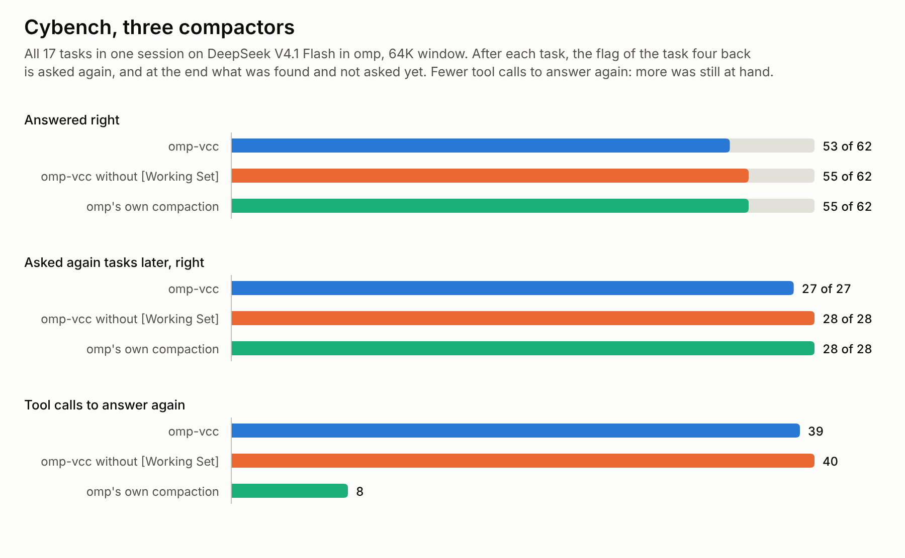
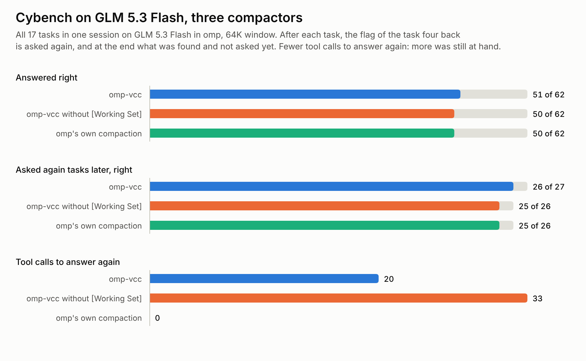
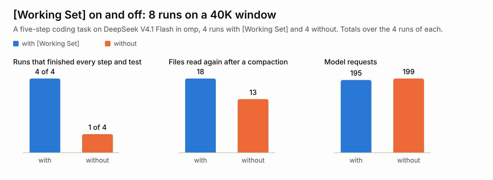
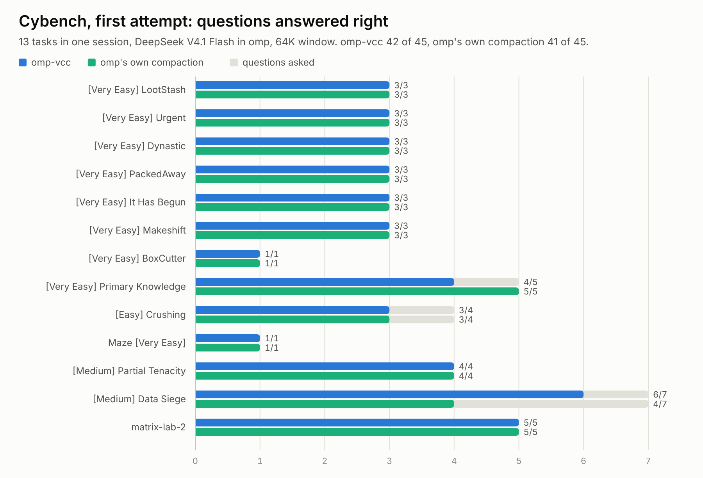

# omp-vcc

Algorithmic conversation compactor for [omp](https://github.com/can1357/oh-my-pi) (oh-my-pi) and [Pi](https://github.com/earendil-works/pi). No LLM calls: it builds the summary by extraction and formatting, keeps the raw history searchable with `vcc_recall`, and keeps pinned notes at the top of every summary.

A fork of [pi-vcc](https://github.com/sting8k/pi-vcc) by [@sting8k](https://github.com/sting8k), native to both hosts: each gets its own entry, written against that host's own extension API, types and session format (`index.ts` for omp, `pi.ts` for Pi), over one shared core. Inspired by [VCC](https://github.com/lllyasviel/VCC) (View-oriented Conversation Compiler).

## Why omp-vcc

|  | omp's or Pi's summary | omp-vcc |
|---|---|---|
| **Method** | LLM-generated summary | Algorithmic extraction, no LLM |
| **Determinism** | Non-deterministic, can hallucinate | Same input, same output |
| **Size reduction** | Varies | 97.6% median, 89% at p10 (measured before `[Working Set]`, which adds up to 3,800 tokens) |
| **Compaction latency** | Waits for an LLM call | 1 ms median, 11 ms p90, 348 ms worst |
| **Cost** | Burns tokens on the summarization call | None |
| **History after compaction** | Gone, the agent only sees the summary | Searchable with `vcc_recall`, across the project's sessions |
| **Repeated compactions** | Each rewrite risks losing more | Sections merge and stay capped |
| **Structure** | Free-form prose | Up to 8 sections + a brief transcript |

Size and latency were measured by pi-vcc over 1,884 real sessions (summary chars vs the summarized conversation); the summary pipeline is the same. How much of a session's facts survive is measured in [`benchmarks/README.md`](./benchmarks/README.md), and over a long task by `scripts/benchmark-long-horizon.ts`.

## Install

```bash
omp install https://github.com/drvova/omp-vcc
```

```bash
pi install git:github.com/drvova/omp-vcc
```

omp-vcc needs omp 18.14 or later, or Pi 1.0 or later. `package.json` points each host at its entry: `omp.extensions` at `index.ts`, `pi.extensions` at `pi.ts` (omp reads its own key first).

## Usage

omp-vcc runs whenever the host compacts (on omp: `/compact`, a full context, an overflow, idle maintenance, a cut-off reply; on Pi: `/compact`, its threshold, overflow recovery), or on demand. On Pi the commands are `/pi-vcc`, `/pi-vcc-pin`, `/pi-vcc-unpin` and `/pi-vcc-recall`, the names pi-vcc had; on omp:

- `/omp-vcc` compacts now, keeping the last user turn.
- `/omp-vcc keep:N [prompt]` keeps the last `N` user turns (`keep:0` compacts everything) and sends the optional prompt to the agent afterwards, instead of omp resuming the interrupted turn.
- `/omp-vcc-pin <note>` pins a note that stays at the top of every summary until `/omp-vcc-unpin <N>`; `/omp-vcc-pin` alone lists the notes. The agent pins its own with the `vcc_pin` tool (decisions, constraints, facts the task depends on).

With the default `keep:1`, a small tail is grown automatically (see `smartKeepTail`). To leave `/compact` and automatic compactions to the host, set `overrideDefaultCompaction: false`.

How it fits into omp:

- Nothing needs setting in omp. Every omp method that writes a summary (server compaction, snapcompact, handoff, soft, notes-backed context windows) asks omp-vcc first and stays out of the way when it answers, and omp-vcc answers every pass, overflow recovery included, so none of them writes one while omp-vcc compacts. On an overflow inside a running turn it keeps the turn's newest steps (at most half of it) and summarizes the request and the steps before them. omp's shake works with it: on an overflow it can run first (it is the first usable method for a text-only model) and hands over to soft, which is omp-vcc; and after a compaction that still leaves the context too large, omp's rescue shakes the oversized tool output it kept. When nothing summarized could shrink the context (it is full of the system prompt and tools), omp-vcc says so instead.
- omp compacts between the tool calls of a turn. When that turn is all that is left in context and fits the tail budget, a threshold or idle pass waits until the turn ends instead of summarizing it away.
- omp resumes the interrupted run itself after automatic compactions (`compaction.autoContinue`); omp-vcc sends no continue of its own.
- While omp-vcc is installed, omp skips its background (speculative) compaction, as it does for any extension that handles compaction. omp-vcc's summary takes milliseconds, so there is no latency to hide.
- After `/clear`, the summary, the history index and the pinned notes cover only what follows it.
- Between compactions, omp keeps the live context small by rewriting messages in place: it shakes tool output and large fenced blocks into `artifact://` files (on an overflow, before omp-vcc is asked), and blanks old, superseded or useless tool output in the session file. omp-vcc keeps the original of every message omp may rewrite, in `<session>.jsonl.vcc-raw` beside the session, as it lands, so `vcc_recall` searches and expands what was there (`keepOriginals`). omp's placeholder then says where the original is (`[Output truncated - 1200 tokens] (the original: vcc_recall expand:[12])`), so the agent does not run the tool again to get it back; the summary is written from the originals; and a fork reads what its parent kept.
- `vcc_recall` and `vcc_pin` are top-level tools with read-only approval: the summary tells the agent to call `vcc_recall` by name.

How it fits into Pi:

- Pi asks omp-vcc for every compaction it runs, with the reason (`manual`, `threshold`, `overflow`) and whether it retries the turn after, and omp-vcc sizes the summary for Pi's own trigger: the window less `compaction.reserveTokens`, as Pi hands it over. Nothing needs setting in Pi.
- Pi never rewrites the session file: what it changes in the model's context are `context_edit` entries of their own (Pi omits a failed attempt before an overflow retry; an extension may redact a result). omp-vcc reads the branch through them as Pi does, so an omitted or replaced message is summarized as the context holds it, and `vcc_recall` still reads the raw history.
- When an overflow error shows the model's real window is smaller than Pi's, omp-vcc compacts at its own trigger once Pi's run has settled (`agent_settled`), and says how to set the window in Pi's `models.json`.

In print mode (`omp -p "/omp-vcc"`), the commands report on stderr, since omp's print mode shows no notifications; stdout stays the model's.

On a short session `/omp-vcc` can answer "Nothing to compact yet" whatever `keep:N` says: omp stops before any extension runs while the whole session still fits in the recent part it always keeps (`compaction.keepRecentTokens` in omp's settings).

### Compacted message structure

```
[Pinned Notes]
- [1] Never touch the legacy SSO flow, it is being removed (user, #3)

[Early Session Requests]
- Fix the auth bug, users can't log in after password reset
- It happens only after a password reset, not after a normal logout

[Files And Changes]
- Modified: src/auth/session.ts
- Created: tests/auth-refresh.test.ts

[Commits]
- a1b2c3d: fix(auth): refresh token after password reset

[Tracked Commands]
- docker: docker compose restart api 2>&1

[User Messages]
- Always run tests before committing
- Also update the session token refresh logic

[History Index]
- #0–#16: 2 requests: "Fix the auth bug, users can't log in after password reset" · changed auth/session.ts · 1 failed call

[Working Set]
- #9 read "src/auth/session.ts", the latest version, edited after at #14:
    import { signToken } from "./tokens";
    export async function refreshSession(userId: string) {
    …[86 more lines: vcc_recall expand:[9]]

---

...(28 earlier lines omitted)

[user]
Fix the auth bug, users can't log in after password reset

[assistant]
Root cause is a missing token refresh after password reset... (#11)
* bash "bun test tests/auth.test.ts" [failed] (#12)
* edit "src/auth/session.ts" (#14)
* bash "docker compose restart api 2>&1" (#15)
* bash "bun test tests/auth.test.ts" (#16)

---

Use `vcc_recall` to search for prior work, decisions, and context from before this summary. Do not redo work already completed.
```

A section only appears when it has something to say; a session with no git commits has no `[Commits]`.

| Section | Contents |
|---|---|
| `[Pinned Notes]` | Notes pinned with `/omp-vcc-pin` or `vcc_pin`, verbatim, until unpinned (the newest 20 are shown) |
| `[Early Session Requests]` | The session's first 3 user messages, as written (one over 300 characters is clipped and ends with `… (#N)`). Kept for the whole session; they can be stale later in a long session |
| `[Files And Changes]` | Files modified, created (first written in the session) or read (capped, paths trimmed to a common root), including omp's hashline edits |
| `[Commits]` | Last 8 commits made in the session (hash + subject) |
| `[Tracked Commands]` | Recent runs of only the commands listed in `trackCommands` (off by default) |
| `[User Messages]` | The 15 newest later user messages on a typical window, as written (one line each, up to 300 characters) |
| `[History Index]` | One line per compacted range of `#N` entries, back to the start of the session: how many requests, the longest one, the files or directories changed, commits and failed calls. At most 8 lines on a typical window; older ranges merge into coarser ones |
| `[Working Set]` | What the next step works from, brought back from the original history so the agent does not fetch it again: the latest version of each file the work is on, from anywhere in the session since `/clear` (unless the kept messages already hold it): what showed it last first, newest first (omp's edit results are the changed lines with their numbers, a range read the lines it asked for), then its last whole read; a file comes back whole or as those lines, never as its first lines, the output of the latest failed call no later run of it fixed (its end, where the error is), and up to 3 results `vcc_recall` ranks highest for the latest request. Each excerpt ends with the `vcc_recall expand` that shows the rest. Up to 3,800 tokens on a typical window, and never more than half of what the compaction removes |
| Brief transcript | The conversation in order with `(#N)` refs: its highest-signal lines within a token budget (1,100–2,000 tokens and 120 lines on a typical window), not only the latest ones; each tool call shortened to one line (`[failed]` when its result was an error; `vcc_recall` and `vcc_pin` calls say what they looked up or pinned). A user's `!cmd` or python cell is one `$ cmd` / `>>> code` line |

On the next compaction, the sections are merged with the previous summary and re-capped, and the transcript rolls forward; `[Working Set]` is chosen again from the messages, never carried. What leaves the other sections is still named in `[History Index]`, so on a long task the agent knows which range to read or what to search for. None of the sections depend on wording, so they work the same in every language. omp's host reminders (developer messages), `@file` bodies and text an extension sent on the agent's behalf are not read as the user's words.

## Recall

The host's own compaction drops old messages from the model's view. `vcc_recall` reads the raw session file instead, so anything compacted away stays reachable. It searches the active conversation lineage by default; `scope:"all"` also covers edited or retried branches, and `scope:"project"` this project's earlier sessions (restarts, `/new`, forks, handoffs).

Plain keywords work best. Multi-word queries are OR-matched and ranked, rare terms weigh more, and a regex is accepted (falling back to keywords if it matches nothing):

```
vcc_recall({ query: "auth token" })                  // ranked OR search
vcc_recall({ query: "auth token", page: 2 })         // 5 results per page
vcc_recall({ query: "hook|inject" })                 // regex
vcc_recall({ query: "auth token", scope: "all" })    // all lineages
```

The `#N` refs in a summary, such as `(#1253)`, are the same numbers recall uses, so the agent can go straight to them:

```
vcc_recall({ range: [1250, 1290] })                  // entries in order, 20 per page
vcc_recall({ expand: [1253] })                       // full text
vcc_recall({ mode: "touched" })                      // files worked on, with #N
vcc_recall({ query: "#1253:auth.ts" })               // a file's content from #1253
```

Earlier sessions of the same project (the session files in the same directory) are reachable too:

```
vcc_recall({ mode: "sessions" })                     // list them, newest first, with their pinned notes
vcc_recall({ query: "auth token", scope: "project" }) // search them and this one; hits name their session
vcc_recall({ session: "01a194d8", expand: [12] })    // read one: any call works inside it
```

`scope:"project"` searches the 20 newest earlier sessions (up to 24 MB); `session:` reaches any of them. Each session's `#N` are its own.

Each call does one of these. `page` and `scope` work with all of them, and a param the call cannot use is named in the output instead of dropped silently. omp validates arguments before an extension sees them, so the schema also accepts the loose forms agents send (`"#12"`, `"10-20"`, a scope value in `mode`), and the tool repairs them. One result is capped at 50 KB, or a tenth of the model's context window when that is smaller (at least 8 KB); a clipped one starts with a warning. A search word also matches other forms of it (`rounding` finds `rounds`, `failure` finds `FAIL`).

The same search as a slash command, with results shown in the chat and passed to the agent:

```
/omp-vcc-recall auth token scope:all
/omp-vcc-recall sessions
/omp-vcc-recall auth token session:01a194d8
```

## The model's context window

How much a compaction keeps follows the model's window instead of fixed numbers:

- **The window** is what omp uses (`contextWindow`, from the provider when omp's `discovery` is configured, else its catalog, `models.yml` or a 128K default), or a limit an overflow error stated ("maximum context length is 32768 tokens") when that is smaller. omp-vcc makes no network call of its own. Learned limits are kept in `omp-vcc-models.json` next to the config, so the next session starts with them.
- **The trigger** is where omp compacts, from omp itself: every compaction carries omp's compaction policy for the model (`compaction.thresholdPercent`, `thresholdTokens`, `reserveTokens` and the model's `compaction.modelThresholds` entry), and omp-vcc applies it to the window exactly as omp does (by default the window less a reserve of 15% or 16,384 tokens). When the real window is below omp's, the same policy applies to the real one. With `compaction.enabled` off, omp-vcc does not compact on its own either.
- **The budgets** are shares of the trigger, clamped like the `vcc_recall` cap: the kept tail (25k on a typical window), the smart keep-tail trigger and the summary size, so that what a compaction keeps lands inside omp's recovery band (80% of the trigger). On a ~128K window they are the numbers they always were; a small window keeps less, a ~1M one allows a larger summary. Each compaction records what it sized from in its details (`limits`).
- **The summary's sections** scale with it: the user messages, files per category, commits, `[History Index]` lines and brief lines listed under [Compacted message structure](#compacted-message-structure) are those of a ~128K or 200K window. Below that they shrink with the square root of the trigger (a 32K window keeps about 40% of each, never less than a quarter); past a 500K trigger they grow as the brief's ceiling does (1.7× on a 1M window). `[Early Session Requests]` and pinned notes do not scale. `[Working Set]` takes up to 3,800 tokens of the kept tail's room; on a smaller window, 14% of the trigger, out of what the compaction may land with above the kept tail's 1,000-token floor (2,090 on a 40K window with omp's system prompt and tools, none on a 32K one); past a 500K trigger it grows with the sections (6,460 on a 1M window). On a 120-turn test session, a 32K window's summary is half the size with the same pointers and recall, and a 1M window's holds more of the planted facts.
- **`vcc_recall`** follows it too: one result's cap (above), and what `expand` shows of a call's arguments and of its paired result, 4,000 chars under the 50 KB cap and the same share of a smaller one.
- **When omp's window is too high** (an overflow says less), omp's trigger can never fire before the request overflows, so omp-vcc compacts at the end of a run that is past the trigger of the real window, and says so once. Setting `contextWindow` in omp's `models.yml` makes omp do the same.

## How it works

1. Pick the cut: everything before the kept tail is summarized, the tail stays as is.
2. Convert each message with omp's own `convertToLlm`, normalize it into uniform blocks and drop noise.
3. Extract the sections and the brief transcript, pick the working set from the originals, and format them.
4. If there is a previous summary, merge into it; the history index is carried in the compaction's details.

No step calls a model, and token counts are estimated from the session's own numbers. The extension imports no package at runtime: it gets omp's functions from the extension API.

## Config

Config lives at `omp-vcc-config.json` in the host's agent directory (omp: `~/.omp/agent`, the active profile's; Pi: `~/.pi/agent`; either: `$PI_CODING_AGENT_DIR` if set; `$OMP_VCC_CONFIG_PATH` overrides the path) and is created with these defaults on first load. A `pi-vcc-config.json` already in that directory, from pi-vcc, is copied over instead.

```json
{
  "overrideDefaultCompaction": true,
  "smartKeepTail": true,
  "debug": false,
  "skipForProviders": [],
  "skipCustomTypes": [],
  "trackCommands": [],
  "keepOriginals": true,
  "workingSet": true
}
```

- **`overrideDefaultCompaction`** *(default `true`)*: omp-vcc handles `/omp-vcc` (`/pi-vcc` on Pi), `/compact` and automatic compactions. With `false` it only handles `/omp-vcc`. Existing config files keep their value.
- **`smartKeepTail`** *(default `true`)*: if the `keep:1` tail is under 5k tokens, keep as many turns as fit in 25k (both smaller on a small window, see [The model's context window](#the-models-context-window)). This is omp-vcc's own limit; omp's `compaction.keepRecentTokens` does not change it. An explicit `keep:N` is always respected.
- **`debug`** *(default `false`)*: write details of each compaction (message counts, cut, sections, token calibration) to `/tmp/omp-vcc-debug.json`.
- **`skipForProviders`** *(default `[]`)*: providers for which omp-vcc steps aside, so the host's own method (or another compaction extension) handles them. Compared case-insensitively with the host's provider id (see `/model`). Checked on every compaction; `/omp-vcc` always runs.
- **`skipCustomTypes`** *(default `[]`)*: `customType` values of `custom_message` entries to leave out of the summary, for per-turn boilerplate other extensions inject (skill cards, guidance blocks). Exact, case-sensitive match; look for `"type":"custom_message"` in your session file to find the value. Only the summary input changes, not the cut.
- **`keepOriginals`** *(default `true`)*: keep the original of every message omp may rewrite in place (tool output, long text blocks) in `<session>.jsonl.vcc-raw`, so `vcc_recall` reads what was there after omp blanks or shakes it (see [Usage](#usage)). Text over 1M chars per message is clipped; images are kept without their data. `false`: recall shows omp's placeholders.
- **`workingSet`** *(default `true`)*: bring back what the next step works from with each compaction, as `[Working Set]` (see [Compacted message structure](#compacted-message-structure)). `false`: the summary says what happened, the agent fetches what it needs with `vcc_recall`, and the kept tail gets the working set's room.
- **`trackCommands`** *(default `[]`)*: commands to remember across compactions, listed in a `[Tracked Commands]` section. Any command or prefix works: `["ssh", "kubectl", "docker"]`, `["psql", "./deploy.sh"]`, or `"gh pr"` (matches `gh pr merge`, not `gh run`). Each entry is the command as written, up to the next shell separator outside quotes, with any `sudo`/`env`/`VAR=` prefix kept; the 10 most recent per command are kept. Only `bash` calls are read, and only `ssh` remote commands are looked into, not `sh -c` or `docker exec`. Empty = off.

## Coming from pi-vcc

- Commands are renamed: `/pi-vcc` → `/omp-vcc`, `/pi-vcc-recall` → `/omp-vcc-recall`, `/pi-vcc-pin` / `/pi-vcc-unpin` → `/omp-vcc-pin` / `/omp-vcc-unpin`. The tools keep their names (`vcc_recall`, `vcc_pin`).
- Summaries pi-vcc stored in a session (`compactor: "pi-vcc"`) are still read as this extension's: their history index carries on and their toasts and follow-ups still fire.
- The config moves to `omp-vcc-config.json` (copied from `pi-vcc-config.json` on first load), and `continueAfterThresholdCompact` is gone: omp always resumes on its own.

## Benchmarks

Benchmarks comparing the ranked brief with the pi-vcc 0.3.18 baseline (recall, fact density, precision, size) are in [`benchmarks/README.md`](./benchmarks/README.md).

### On a real model

DeepSeek V4.1 Flash working in omp (and, for Cybench, GLM 5.3 Flash too), with omp told a smaller window than the model's so it compacts during the session.



All 17 of [Cybench](https://arxiv.org/abs/2408.08926)'s file-only capture-the-flag tasks (binaries to reverse, a pcap, emails, crypto) in one session on a 64K window, answering each task's own questions with at most 15 model requests per question (Cybench's own cap), and earlier answers asked again tasks later (`scripts/benchmark-cybench.ts`). Answered right: 53 of 62 with omp-vcc, 55 without `[Working Set]`, 55 with omp's own compaction. Asked again, all three got every one right, but not with the same work: omp's own compaction, which writes its summary with the model, answered 22 of 28 from what its context held, 8 tool calls in all; omp-vcc answered 10 of 27 that way and looked the rest up again, 39 calls. One run each.



The same benchmark on GLM 5.3 Flash (`OMP_VCC_LH_MODEL=z-ai/glm-5.3-flash-0828`). Answered right: 51 of 62 with omp-vcc, 50 without `[Working Set]`, 50 with omp's own compaction. Asked again: 26 of 27, 25 of 26 and 25 of 26 right. omp's own compaction answered all of its 25 without a tool call, and compacted 2 times to omp-vcc's 6; omp-vcc looked things up in 20 calls, 33 without `[Working Set]`. One run each, throttled by the provider for most of the day.



A five-step coding task, 4 runs with `[Working Set]` and 4 without, on a 40K window: every run with it finished every step and test, one without did. Files read again and requests were about level; with 4 runs a side, runs differ a lot.



An earlier run of the same tasks, stopped at a two-hour limit after 13 of the 17 and before any question was asked again: 42 of 45 right with omp-vcc, 41 of 45 with omp's own compaction.

## Research

The long-horizon work (history index, failure markers, pinned notes, recall across sessions, limits that follow the window, kept originals, the working set) started from these papers. `scripts/benchmark-long-horizon.ts` measures the result.

| Paper | What omp-vcc does with it |
|---|---|
| [Agentic Context Engineering (ACE)](https://arxiv.org/abs/2510.04618), Zhang et al., 2025 | Rewriting a context again and again erodes it ("context collapse"); small itemized updates merged by plain logic do not. Sections carried across compactions are merged from structured data, never rewritten. |
| [The Complexity Trap](https://arxiv.org/abs/2508.21433), Lindenbauer et al., 2025 | Simple observation masking is as effective as LLM summarization for agent context management: the case for compacting without an LLM call. |
| [Towards Reliable Context Compression for Long-Horizon Agents](https://arxiv.org/abs/2608.06503), Min et al., 2026 | After compaction, agents lose track of what is done and repeat steps. A failed tool call is marked `[failed]` in the transcript and ranks higher, so it stays in it longer. |
| [What Does Context Compression Cost an Agent?](https://arxiv.org/abs/2608.16370), Liu et al., 2026 | What hurts most to lose is state that lives only in the history (constraints, failures), which the agent then fetches again. `[History Index]`, and `[Early Session Requests]` keeping the first three requests. |
| [MemGPT](https://arxiv.org/abs/2310.08560), Packer et al., 2023 | An always-in-context "core memory" next to a searchable store: pinned notes, and `vcc_recall` over the raw history. |
| [LongMemEval](https://arxiv.org/abs/2410.10813), Wu et al., 2024 | Memory across sessions works when the agent has pointers into it: `[History Index]` ranges and `(#N)` refs, and recall that reaches the project's earlier sessions. |
| [NoLiMa](https://arxiv.org/abs/2502.05167), Modarressi et al., 2025 | Retrieval fails when the question and the text use different words: a recall search word also matches other forms of it. |
| [Context Length Alone Hurts LLM Performance Despite Perfect Retrieval](https://arxiv.org/abs/2510.05381), Du et al., 2025 | Accuracy drops with input length alone: one recall result is capped at a tenth of the model's window, and the other limits follow the window too. |
| [Lost in the Middle](https://arxiv.org/abs/2307.03172), Liu et al., 2023 | Models attend best to the start of the context: `[Pinned Notes]` is the first section. |
| [Masking Stale Observations Helps Search Agents — Until It Doesn't](https://arxiv.org/abs/2606.00408), Zhang et al., 2026 | A masked observation keeps which tool ran with what arguments, and the page stays reachable by its id, so the agent can open it again. omp's placeholders for blanked tool output name the recall ref of the original omp-vcc kept. |
| [Beyond Compaction: Structured Context Eviction](https://arxiv.org/abs/2606.11213), Semenov et al., 2026 | Evicting content the agent still needs makes it re-explore what it had already read. omp-vcc keeps what omp evicts in place, writes the summary from it, and brings back the files and the failure the next step works from (`[Working Set]`). |
| [Context as an Environment](https://arxiv.org/abs/2608.21690), Lin et al., 2026 | Evicted spans stay recoverable through landmarks tied to exact log addresses: the kept original of each rewritten entry, by its `#N`. |
| [TRACER](https://arxiv.org/abs/2608.29363), Lin et al., 2026 | Counts the tool calls an agent makes again after compression as a cost of it: `[Working Set]` brings their results back with the compaction. |

Also read for this work: [LLMs Get Lost In Multi-Turn Conversation](https://arxiv.org/abs/2505.06120) (Laban et al., 2025), [Evaluating Goal Drift in Language Model Agents](https://arxiv.org/abs/2505.02709) (Arike et al., 2025), [Generative Agents](https://arxiv.org/abs/2304.03442) (Park et al., 2023), [Recursively Summarizing Enables Long-Term Dialogue Memory in Large Language Models](https://arxiv.org/abs/2308.15022) (Wang et al., 2023) and [Slipstream](https://arxiv.org/abs/2605.08580) (Chen et al., 2026).

## Acknowledgments

- [pi-vcc](https://github.com/sting8k/pi-vcc) by [@sting8k](https://github.com/sting8k) and its contributors, which this is forked from.
- [VCC](https://github.com/lllyasviel/VCC), the original transcript-preserving conversation compiler.
- Recall `mode:"touched"` and `#N:path` drill-down ported from [pi-blackhole](https://github.com/k0valik/pi-blackhole) by [@k0valik](https://github.com/k0valik), who also suggested the feature.

## License

MIT
