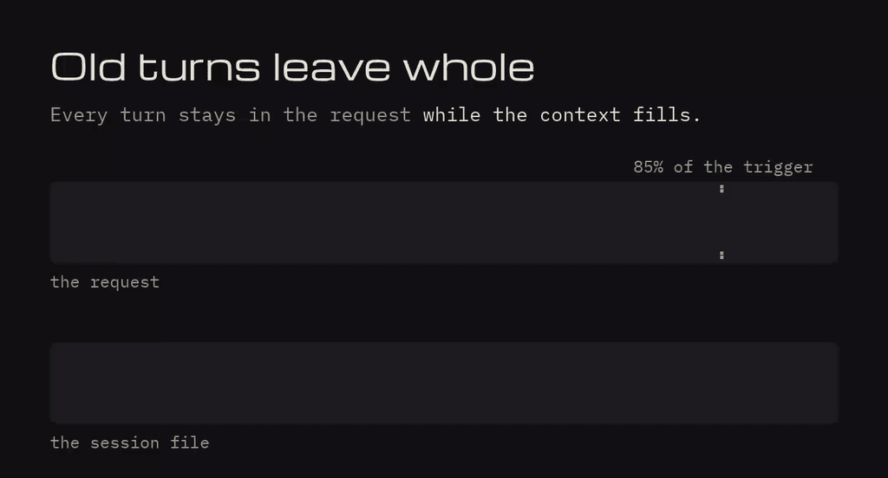

# keel

Context management for [omp](https://github.com/can1357/oh-my-pi) (oh-my-pi) and [Pi](https://github.com/earendil-works/pi) coding agents, without an LLM call. When the context fills, keel makes room in two ways, both on out of the box, and nothing it removes is lost:

- **Turns out whole**: old turns leave the request word for word, a one-line pointer stands in their place.
- **A summary**, built by extraction, not by a model, for every compaction the host still runs (`/compact`, an overflow, nothing left to take out).

Either way the session file keeps everything, and the agent reads any of it back with `keel_recall`, across the project's earlier sessions too. Pinned notes stay in view throughout.



Earlier releases were called omp-vcc and, before that, pi-vcc. Sessions, configs and commands written under those names still work ([coming from an earlier release](#coming-from-omp-vcc-or-pi-vcc)).

keel grew out of [pi-vcc](https://github.com/sting8k/pi-vcc) by [@sting8k](https://github.com/sting8k), inspired by [VCC](https://github.com/lllyasviel/VCC) (View-oriented Conversation Compiler). It is its own project now: a native entry for each host over one core in Common Lisp ([why](#the-core-common-lisp-on-sbcl)).

|  | The host's own summary | keel |
|---|---|---|
| **Method** | An LLM writes it | Extraction and formatting, no LLM |
| **Determinism** | Can vary and hallucinate | Same input, same output |
| **Latency** | An LLM call | 1 ms median, 11 ms p90 |
| **Cost** | The summarization call's tokens | None |
| **Size** | Varies | 97.6% smaller at the median, 89% at p10 |
| **After it** | Old messages gone | Every word searchable with `keel_recall` |
| **Again and again** | Each rewrite can lose more | Sections merge from stored data and stay capped |

Measured by pi-vcc over 1,884 real sessions, before `[Working Set]` (up to 3,800 tokens more); the pipeline is the same.

## Contents

- [Install](#install) · [Quick start](#quick-start) · [Commands and tools](#commands-and-tools)
- Making room: [the summary](#the-summary) · [turns out whole](#turns-out-whole)
- [Recall](#recall) · [Pinned notes](#pinned-notes) · [The window and the tokens](#the-window-and-the-tokens)
- [Config](#config) · [On omp, on Pi](#on-omp-on-pi) · [The core](#the-core-common-lisp-on-sbcl)
- [Benchmarks](#benchmarks) · [Research](#research) · [Coming from omp-vcc or pi-vcc](#coming-from-omp-vcc-or-pi-vcc)

## Install

```bash
omp install https://github.com/drvova/keel
```

```bash
pi install git:github.com/drvova/keel
```

It needs omp 18.14+ or Pi 1.0+, and [SBCL](https://www.sbcl.org/) on the `PATH` (or named by `SBCL`): `sudo apt install sbcl` on Debian/Ubuntu, `brew install sbcl` on macOS.

The first load builds the core with that SBCL: a few seconds, once per version, into `lisp/build/` (`KEEL_CORE_BUILD_DIR` when the install directory is read-only). Until it is built, or without SBCL, keel steps aside, says why once, and the host compacts as it would without it.

## Quick start

Nothing needs configuring. Once installed, old turns leave the context whole as it fills, keel writes every compaction the host still runs (`/compact`, an overflow), and the agent has `keel_recall`, `keel_pin`, `keel_context` and its context as an editable file.

To summarize instead of taking turns out, set `"evict": false` in `keel-config.json` (see [Config](#config)) and start a new session.

## Commands and tools

The commands start `/keel` on both hosts; their old names (`/omp-vcc…` on omp, `/pi-vcc…` on Pi) still work.

| Command | What it does |
|---|---|
| `/keel [keep:N] [prompt]` | Compact now, keeping the last `N` user turns (default 1, grown a little by `smartKeepTail`; `keep:0` compacts everything), then send `prompt` instead of resuming |
| `/keel-recall …` | Search the history, as `keel_recall` does ([Recall](#recall)) |
| `/keel-pin [name:NAME] <note>` | Pin a note; with none, list them ([Pinned notes](#pinned-notes)) |
| `/keel-unpin <N or name>` | Unpin a note |
| `/keel-evict …` | Take old turns out whole, bring them back, undo, or list ([Turns out whole](#turns-out-whole)) |

| Tool (the agent's) | What it does |
|---|---|
| `keel_recall` | Search and read the raw history by query, `#N`, range, file or session |
| `keel_pin` | Pin, name, redefine or unpin a note |
| `keel_context` | With `evict` on: list what is in context, take turns out or bring them back, undo |

In print mode the commands report on stderr. On a short session `/keel` may answer "Nothing to compact yet": the host holds back a recent part (`compaction.keepRecentTokens`) before any extension runs.

## The summary

```
[Pinned Notes]
- [1] Never touch the legacy SSO flow, it is being removed (user, #3)

[Task State]
- Request (#14): Also update the session token refresh logic
- Since then: 4 tool calls, 1 failed; changed src/auth/session.ts.
- Last result (#16): bash "bun test tests/auth.test.ts"

[Early Session Requests]
- Fix the auth bug, users can't log in after password reset

[Files And Changes]
- Modified: src/auth/session.ts
- Created: tests/auth-refresh.test.ts

[Commits]
- a1b2c3d: fix(auth): refresh token after password reset

[History Index]
- #0–#16: 2 requests: "Fix the auth bug, users can't log in after password reset" · changed auth/session.ts · 1 failed call

[Working Set]
- #9 read "src/auth/session.ts", the latest version, edited after at #14:
    import { signToken } from "./tokens";
    …[86 more lines: keel_recall expand:[9]]

---

[user]
Fix the auth bug, users can't log in after password reset

[assistant]
Root cause is a missing token refresh after password reset... (#11)
* bash "bun test tests/auth.test.ts" [failed] (#12)
* edit "src/auth/session.ts" (#14)
```

Every `(#N)` is an entry `keel_recall` reads back exactly. A section appears only when it has something to say.

| Section | What it holds |
|---|---|
| `[Pinned Notes]` | Pinned notes, verbatim (the newest 20) |
| `[Task State]` | Where the work stands: the latest request, the calls since and their failures, the files changed, the last result, the failure no later run fixed. Rebuilt each time |
| `[Early Session Requests]` | The session's first 3 user messages, as written |
| `[Files And Changes]` | Files modified, created and read |
| `[Commits]` | The last 8 commits made in the session |
| `[Tracked Commands]` | Recent runs of the commands in `trackCommands` (off by default) |
| `[User Messages]` | The 15 newest later user messages |
| `[History Index]` | One line per compacted range back to the session's start: requests, files, commits, failed calls (8 lines; older ranges merge) |
| `[Working Set]` | What the next step works from, brought back so the agent does not fetch it again: the latest version of each file being worked on, the output of the open failure, and recall's best hits for the latest request. Up to 3,800 tokens, never more than half of what the compaction removes |
| Brief transcript | The conversation's highest-signal lines in order, one line per tool call, `[failed]` marked |

Sizes fit a ~128K–200K window and follow the model's ([The window and the tokens](#the-window-and-the-tokens)). Sections merge from the previous compaction's stored state, never rewritten from its text, so detail survives compaction after compaction; `[Working Set]` and `[Task State]` are chosen fresh each time. None of it depends on wording, so it works in every language.

## Turns out whole

Instead of a summary over the oldest part of the window, old turns leave the request whole: nothing summarized or rewritten, the session keeps every word. A turn is a request and everything after it, so a call never leaves without its result; the running turn's older steps can leave too, its request and newest step never. A big tool result (a sixteenth of the trigger or more) leaves on its own first — its call stays, its content becomes one line pointing at `keel_recall expand` — and a tool output word for word one still in the request is sent as one line naming the first.

**You** take turns out with `/keel-evict` at any time, with eviction on or off:

| Argument | What leaves or comes back |
|---|---|
| *(none)* | The oldest half of the turns in context |
| `3` · `all` · `#12-#40` | The three oldest · every finished turn · the turns that range touches |
| `restore #12` · `restore all` | Back in context |
| `undo` | The last edit reversed, whole |
| `list` | What is in and what is out, by `#N` and size |

**With eviction on** (the default; `"evict": false` turns it off):

- **The agent** decides too, with `keel_context`: `drop`, `oldest`, `restore`, `undo`, a `note` kept in their place. A drop that would cost more than it saves is held back with the run that would pay for it; `force: true` takes it out anyway.
- **keel** takes the oldest finished turns out by itself past 85% of the host's trigger, down to half of it. An overflow recovery, `/compact` and `/keel` still summarize.
- **What the agent recalls steers it.** A turn recalled in the last three turns leaves last of the finished turns, whatever its age, and a turn out of context that the agent recalled since comes back by itself when that costs less than the recalls it would still take. keel learns that per model — how often it recalls a turn again having recalled it once, weighed at the session's own prices — and a compaction's `[Working Set]` brings back what was recalled lately first.
- **What each eviction cost is learned, by kind of turn.** A turn recalled after eviction cost a request; one never revisited cost nothing. keel counts that per kind (a failed run, changed files, only reads) per model, and a kind the model recalls twice as often as the cheapest leaves after the others. With no evidence, the oldest go first.
- **Linked turns stay together.** A turn that changes a file an earlier turn changed, or passes what failed in it, carries that turn along: keel never cuts inside such a chain, and bringing one back brings the linked ones.
- **The context as a file.** Each request is mirrored beside the session (`<session>.jsonl.keel-context.md`), one block per turn; the agent edits it with its own tools — delete a block and the turn leaves, rewrite it and that stands instead. Every edit is a `keel.evict` entry, so a branch keeps its own and `/tree` back past one undoes it. Turns leave in large runs from the oldest end, since every edit makes the provider re-read all that follows it.

What the request then carries, each part worded to read the same on every request so the provider's prompt cache keeps it: a line per range out (what it was, how to read it back), the turns still in (`[#21]` numbers let the agent name turns without listing them), the pinned notes first, and a **dashboard** last — how full the context is, the largest turns by `#N`, what is out. Agents misjudge their own context by 43–84% without one and not at all with it ([VISTA](https://arxiv.org/abs/2606.30005)); it is remade each request and never kept, and says what is left, since models read a remaining budget better than a share.

## Recall

`keel_recall` reads the raw session file, so anything compacted or evicted stays reachable: the active branch by default, `scope:"all"` for edited and retried branches too, `scope:"project"` for the project's earlier sessions (restarts, `/new`, forks, omp's handoffs).

```
keel_recall({ query: "auth token" })                    // ranked search: rare words weigh more, other forms of a word match
keel_recall({ query: "hook|inject" })                   // a regex (as text when it matches nothing)
keel_recall({ expand: [1253] })                         // an entry in full: the (#1253) of a summary
keel_recall({ range: [1250, 1290] })                    // entries in order
keel_recall({ mode: "touched" })                        // files worked on, with #N
keel_recall({ query: "#1253:auth.ts" })                 // a file's content at #1253
keel_recall({ mode: "sessions" })                       // the project's sessions, with their pinned notes
keel_recall({ query: "auth token", scope: "project" })  // search them too
keel_recall({ session: "01a194d8", expand: [12] })      // inside another session (its own #N)
```

Superseded entries say so (`(superseded: src/auth.ts changed at #52)`, `(fixed: passed at #61)`). Results come 5 a page; near-copies push each other down so a page shows five different things, and one result is capped at 50 KB or a tenth of the window. The tool repairs the loose forms agents send (`"#12"`, `"10-20"`) and names a param it cannot use instead of dropping it. `/keel-recall auth token scope:all` runs the same search for you.

## Pinned notes

What must survive everything: a decision and its reason, a constraint, the command the task runs. Kept verbatim at the top of every summary, and first in the request with eviction on.

- **Named notes** (`keel_pin {note, name}` or `/keel-pin name:…`): pinning the name again replaces the note, so a plan stays current under one name.
- **Yours stay yours:** the agent cannot redefine or unpin a note you pinned; it is told to ask you.
- **Into the next session:** your named notes carry over (a restart, `/new`). The agent's do not — an instruction carried into every later session is how an injection persists — but it finds them with `keel_recall` sessions and re-pins what still holds.
- **Where the last session stopped:** a new session gets one message with your first prompt — the last session's request, its calls and what they changed, the failure it left open, the failures it fixed and what fixed them — read from its transcript by rule, with no model. Tool output is not carried, only calls and `#N`; a file written since is named (`Changed since it ended: src/auth.ts. What it says of it may no longer hold.`).

## The window and the tokens

Every size follows the model's real window, learned from what the provider proves rather than trusted from a catalog. Catalogs disagree: one DeepSeek model is listed anywhere from 131K to 1.05M across providers, and one Claude model moved from 1M to 200K between two Pi releases.

- **The window** is the host's (on omp the provider's when its discovery is configured, else its catalog or `models.yml`; on Pi its catalog or `models.json`), lowered to any limit an overflow error stated, however the provider phrases it. If the provider later accepts a larger prompt, the limit was wrong and is dropped.
- **Tokens** are counted at the model's own chars per token, measured on each request from the provider's counts (code runs ~3.8, English prose ~5.4, Chinese and Japanese 1–2). keel sizes from the lowest of the last eight values measured, so its estimate errs high: too high and a turn leaves a little early, too low and the request overflows.
- **What it learns is kept** per model in `keel-models.json` beside the config, so the next session starts with it. keel makes no network call of its own.
- **The trigger** is where the host compacts, from the host's own settings for the model, applied as the host applies them (omp's threshold, reserve and per-model thresholds; Pi's `reserveTokens`).
- **The budgets** are shares of the trigger, sized for the window (a 25k kept tail on ~128K; each compaction records what it sized from). A window set too high never triggers the host, so keel compacts at the end of a run past the real trigger, and says so once.

## Config

`keel-config.json` lives in the host's agent directory (`~/.omp/agent` or the active profile's; `~/.pi/agent`; `$PI_CODING_AGENT_DIR`); `$KEEL_CONFIG_PATH` overrides. It is created with these defaults; an omp-vcc or pi-vcc config there is copied over.

```json
{
  "overrideDefaultCompaction": true,
  "smartKeepTail": true,
  "debug": false,
  "skipForProviders": [],
  "skipCustomTypes": [],
  "trackCommands": [],
  "keepOriginals": true,
  "workingSet": true,
  "evict": true
}
```

| Key | Default | What it does |
|---|---|---|
| `overrideDefaultCompaction` | `true` | keel writes `/compact` and automatic compactions; `false`: only its own command |
| `smartKeepTail` | `true` | A `keep:1` tail under 5k tokens grows to the turns that fit in 25k (smaller on a small window); an explicit `keep:N` is kept |
| `debug` | `false` | Each compaction's details (counts, cut, sections, calibration) in `keel-debug.json` |
| `skipForProviders` | `[]` | Providers whose compactions the host keeps (case-insensitive provider ids) |
| `skipCustomTypes` | `[]` | `custom_message` types left out of the summary (other extensions' per-turn boilerplate) |
| `trackCommands` | `[]` | Commands remembered in `[Tracked Commands]`, by command or prefix (`"ssh"`, `"gh pr"`) |
| `keepOriginals` | `true` | omp only: keep the original of what omp rewrites in place, in `<session>.jsonl.keel-raw` |
| `workingSet` | `true` | Bring back what the next step works from as `[Working Set]` |
| `evict` | `true` | Turns out whole as the context fills, `keel_context`, and the context as a file (from the next session) |

## On omp, on Pi

<details>
<summary><b>On omp</b></summary>

- keel writes the compaction on `/compact`, a full context, an overflow, idle maintenance and a cut-off reply, answering every omp method that writes a summary so none of them writes one. On an overflow inside a running turn it keeps the turn's newest steps and summarizes the rest.
- omp's shake still works with it: on an overflow shake can run first and hand over to soft (keel), and after a compaction that still leaves too much, omp's rescue shakes the output it kept.
- A pass that would summarize away a running turn that fits the tail waits until the turn ends. omp resumes the run itself after automatic compactions, and skips its background compaction while keel is installed (keel takes milliseconds).
- omp rewrites messages in place between compactions (shaking output into `artifact://` files, blanking old or superseded results). keel keeps every original as it lands (`keepOriginals`), so recall reads what was there and omp's placeholder points at it: `[Output truncated - 1200 tokens] (the original: keel_recall expand:[12])`.
- After `/clear`, the summary, the history index and the notes cover what follows it. A message the user sends mid-run stays in the running turn.

</details>

<details>
<summary><b>On Pi</b></summary>

- keel writes the compaction on `/compact`, Pi's threshold and its overflow recovery; Pi asks it for every one, and resumes the run itself.
- Pi never rewrites the session file; what it changes in the context are `context_edit` entries. The summary reads the branch through them as Pi does; recall reads the raw history.
- A `!cmd` is one line of the summary; a `!!cmd`, which Pi keeps out of the context, is left out of it too.
- When an overflow shows the real window is smaller than Pi's, keel compacts at its own trigger once the run settles, and says how to set the window in `models.json`.

</details>

## The core: Common Lisp on SBCL

Everything keel decides is decided in one core, `lisp/`, written in Common Lisp and compiled by [SBCL](https://www.sbcl.org/). The hosts load only JavaScript and TypeScript extensions, so `index.ts`, `pi.ts` and `src/` are a thin binding that decides nothing: they do what only the host can (its events, its session manager, its message conversion) and hand everything else to the core, one JSON request and one JSON answer. Even the tools' text and the commands are defined in the core; its answer says what the host should do (append an entry, tell the user, send a message), and the binding does it.

**How it runs.** On first load keel compiles the sources into one executable (~40 MB, linking only libc and libm). Where the system has named pipes, one core process stays up beside the host and answers every request in about 0.4 ms, keeping the session files it read parsed and only reading the lines they gained; on Windows each request starts its own process (about 5 ms). A core that dies is replaced; one that cannot be built yet leaves the host to compact as it would without keel.

**Why Common Lisp and SBCL:**

- **One core for two hosts.** The summary, recall, eviction and window rules exist once, so the two hosts cannot drift apart.
- **Nothing to fetch.** Only SBCL is needed — the JSON, regex engine and test runner are its own — so there is no registry supply chain beyond SBCL itself.
- **Native speed and a long-lived image.** SBCL compiles to machine code, and a Lisp image stays up holding state, which lets the core keep sessions parsed between requests.
- **A system made of definitions.** A Lisp program is named definitions in a running image — the shape keel follows with the agent's named context entries.
- **Exactness where it matters.** JavaScript's arithmetic and regex dialect, checked against JavaScript itself on 1,620 patterns, so every number handed to TypeScript means the same there. Session text is never given to the Lisp reader.

The cost: SBCL has to be installed. Contributor notes on the core, its ops and its tests are in [AGENTS.md](./AGENTS.md).

## Benchmarks

On a real model — DeepSeek V4.1 Flash in omp, told a smaller window so the context fills (`scripts/benchmark-long-horizon.ts`, `scripts/benchmark-cybench.ts`; `--host=pi` for Pi). Single runs unless noted. The brief's own benchmarks against pi-vcc 0.3.18 are in [`benchmarks/README.md`](./benchmarks/README.md).

**[Cybench](https://arxiv.org/abs/2408.08926)**: all 17 file-only capture-the-flag tasks in one session on a 64K window, ≤15 requests per task, earlier answers asked again tasks later.

| | keel summary | without `[Working Set]` | omp's own (LLM) | keel, turns out whole |
|---|---|---|---|---|
| Answered right | 53/62 | 55/62 | 55/62 | 54/62 |
| Asked again, right | 27/27 | – | 28/28 | 28/28 |
| Tool calls to answer again | 39–41 | – | 8 | 56 |
| Compactions | 8 | – | – | 4 |

omp's own compaction answered most re-asked questions from its context; keel looked more of them up again, at no summarization cost. On GLM 5.3 Flash: 51/62 with keel, 50 without `[Working Set]`, 50 with omp's own.


**Long horizon**: 7 facts planted in 60 or 120 coding turns. On a 128K window, turns out whole never compacted and still held all 7 facts word for word after 60 turns (4 after 120, where the summary held 1). On a 32K window one turn fills much of it, eviction often has nothing to take, and the summary carries the session.

**`[Working Set]`**: a five-step coding task on a 40K window, 4 runs a side: every run with it finished every step, one without did.

## Research

<details>
<summary>The papers it builds on</summary>

| Paper | What keel does with it |
|---|---|
| [Context Language Models](https://arxiv.org/abs/2609.37725), Shao et al., 2026 | The model edits its own context: `keel_context` and the context as a file; one large edit from the oldest end; notes that stand first |
| [Agentic Context Engineering](https://arxiv.org/abs/2510.04618), Zhang et al., 2025 | Rewriting a context erodes it: sections merge from stored data, never rewritten |
| [The Complexity Trap](https://arxiv.org/abs/2508.21433), Lindenbauer et al., 2025 | Masking is as effective as LLM summarization: compaction without an LLM call |
| [Towards Reliable Context Compression](https://arxiv.org/abs/2608.06503), Min et al., 2026 | Agents repeat steps after compaction: failed calls marked and ranked up, `[Task State]` |
| [What Does Context Compression Cost an Agent?](https://arxiv.org/abs/2608.16370), Liu et al., 2026 | State that lives only in the history is what hurts to lose: `[History Index]`, early requests |
| [MemGPT](https://arxiv.org/abs/2310.08560), Packer et al., 2023 | A core memory beside a searchable store: pinned notes and `keel_recall` |
| [LongMemEval](https://arxiv.org/abs/2410.10813), Wu et al., 2024 | Memory works through pointers: `#N` refs, ranges, recall across sessions |
| [NoLiMa](https://arxiv.org/abs/2502.05167), Modarressi et al., 2025 | Retrieval fails on reworded queries: a search word matches its other forms |
| [Context Length Alone Hurts](https://arxiv.org/abs/2510.05381), Du et al., 2025 | Length alone costs accuracy: recall's cap and every limit follow the window |
| [Lost in the Middle](https://arxiv.org/abs/2307.03172), Liu et al., 2023 | The start of the context is read best: pinned notes first |
| [Masking Stale Observations](https://arxiv.org/abs/2606.00408), Zhang et al., 2026 | A masked result must stay reachable: omp's placeholders point at the kept original |
| [Beyond Compaction: Structured Context Eviction](https://arxiv.org/abs/2606.11213), Semenov et al., 2026 | Evicting what the agent needs makes it re-explore: `[Working Set]`, originals kept |
| [Context as an Environment](https://arxiv.org/abs/2608.21690), Lin et al., 2026 | Evicted spans recoverable by exact addresses: originals by `#N` |
| [TRACER](https://arxiv.org/abs/2608.29363), Lin et al., 2026 | Calls made again after compression are its cost: `[Working Set]` brings their results back |
| [Budget-Aware Tool-Use](https://arxiv.org/abs/2511.17006), Liu et al., 2025 | A remaining-budget signal: the dashboard's `~N left` |

Also read: [LLMs Get Lost In Multi-Turn Conversation](https://arxiv.org/abs/2505.06120), [Evaluating Goal Drift](https://arxiv.org/abs/2505.02709), [Generative Agents](https://arxiv.org/abs/2304.03442), [Recursively Summarizing](https://arxiv.org/abs/2308.15022), [Slipstream](https://arxiv.org/abs/2605.08580), and [nodecode](https://nodecode.ai/docs/context)'s context design.

</details>

## Coming from omp-vcc or pi-vcc

<details>
<summary>keel is those releases, renamed — nothing written under either name is stranded</summary>

- Commands `/keel`, `/keel-recall`, `/keel-pin`, `/keel-unpin`, `/keel-evict` on both hosts; the old names still run them (`/omp-vcc…` on omp, `/pi-vcc…` on Pi).
- Tools `keel_recall`, `keel_pin`, `keel_context` (were `vcc_…`). A pre-rename summary still names `vcc_recall` until the next compaction rewrites it from stored state.
- Sessions carry over: summaries (`compactor: "omp-vcc"` / `"pi-vcc"`), pinned notes and evicted turns (`omp-vcc.pin`, `omp-vcc.evict`), and omp's kept originals (`.vcc-raw`).
- Config is `keel-config.json`, copied once from `omp-vcc-config.json` (else `pi-vcc-config.json`). `OMP_VCC_CONFIG_PATH`, `OMP_VCC_CORE`, `OMP_VCC_CORE_BUILD_DIR`, `OMP_VCC_CORE_LIVE` are still read when the `KEEL_` name is unset; learned models move to `keel-models.json`, read from `omp-vcc-models.json` until then.
- From pi-vcc: `continueAfterThresholdCompact` is gone — both hosts resume the run on their own.
- The package is `@drvova/keel` from [drvova/keel](https://github.com/drvova/keel). The earlier `drvova/pi-vcc` repository is archived and points here.

</details>

## Acknowledgments

- [pi-vcc](https://github.com/sting8k/pi-vcc) by [@sting8k](https://github.com/sting8k) and its contributors, which keel grew out of, and whose 0.11.2 release is where its history starts.
- [VCC](https://github.com/lllyasviel/VCC), the original transcript-preserving conversation compiler.
- Recall's `mode:"touched"` and `#N:path` drill-down from [pi-blackhole](https://github.com/k0valik/pi-blackhole) by [@k0valik](https://github.com/k0valik), who also suggested them.

## License

MIT
